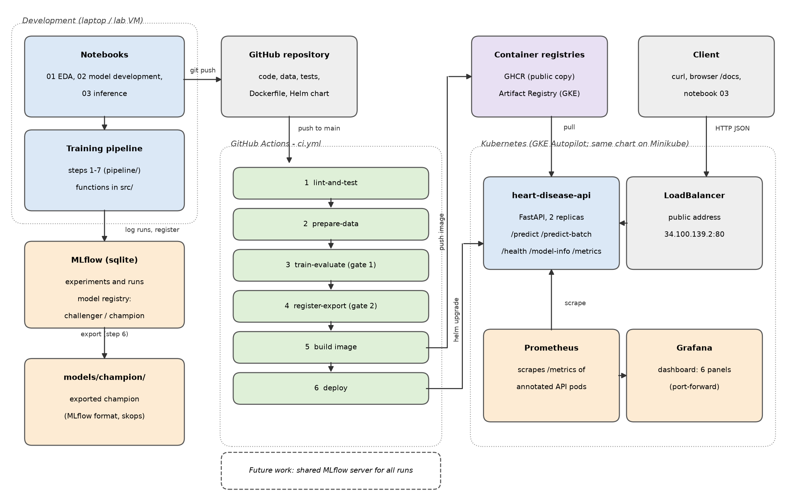

# Heart Disease Prediction - MLOps Assignment 1

This project trains a model to predict whether a patient has heart disease,
using the Cleveland data of the UCI Heart Disease dataset. The model is
trained and deployed through an automated pipeline: it is tracked in MLflow,
packaged as a Docker image, served as an API on Kubernetes, and monitored
with Prometheus and Grafana.

## Architecture



## Project structure

| Folder or file | Contents |
|---|---|
| `data/raw/`, `data/processed/` | The UCI files, and the cleaned file used for training |
| `notebooks/` | 01 data and EDA, 02 model development, 03 inference |
| `src/` | All functions: data, preprocessing, models, MLflow tracking, export |
| `pipeline/` | The training pipeline, one file per step |
| `api/` | The prediction API (FastAPI) |
| `Dockerfile` | The Docker image of the API |
| `deployment/helm/` | Helm chart of the API |
| `deployment/monitoring/` | Settings of Prometheus and Grafana, and the dashboard |
| `tests/` | Unit tests |
| `.github/workflows/` | CI/CD pipeline and the weekly data check |
| `report/figures/` | Plots saved by notebooks 01 and 02, and the architecture diagram |
| `screenshots/` | Screenshots of the runs |

## Setup

Python 3.12. All commands are run from the project folder.

```bash
python -m venv .venv
source .venv/bin/activate        # on Windows: .venv\Scripts\activate
pip install -r requirements.txt
```

## Run order

There are two ways to get a champion model. Only the pipeline registers and
exports the model, so it is run in both.

**A. Pipeline only**

```bash
python -m pipeline.run_all
```

**B. With the notebooks**

1. Run `notebooks/01_data_acquisition_and_eda.ipynb`.
2. Run `notebooks/02_model_development.ipynb`.
3. Run `python -m pipeline.run_all`.

The notebooks and the pipeline write to the same MLflow store (`mlflow.db`
and `mlruns/`), so all runs are seen together.

**Then, for both**

```bash
# 1. build the image inside Minikube
minikube start
eval $(minikube docker-env)
docker build -t heart-disease-api:local .

# 2. deploy the API with Helm and reach it on port 8000
helm upgrade --install heart-disease-api deployment/helm/heart-disease-api \
  --set image.repository=heart-disease-api --set image.tag=local --wait
kubectl port-forward svc/heart-disease-api 8000:80
```

3. Run `notebooks/03_inference.ipynb`, or send the sample request (see below).
4. Optional: run `python -m pipeline.run_all` again. The new version stays
   challenger, as it is not better than the champion.
5. Optional: view the runs, versions and aliases in MLflow:

```bash
mlflow ui --backend-store-uri sqlite:///mlflow.db --port 5000
```

## Prediction API

| Endpoint | Method | Purpose |
|---|---|---|
| `/predict` | POST | Prediction and confidence for one patient |
| `/predict-batch` | POST | Predictions for up to 100 patients |
| `/health` | GET | Whether the model is loaded |
| `/model-info` | GET | Name, version, MLflow run ID and training time of the model |
| `/metrics` | GET | Metrics for Prometheus |

```bash
curl -X POST http://127.0.0.1:8000/predict \
  -H "Content-Type: application/json" -d @api/sample_request.json
```

A request must have all 13 features of the patient. Only `ca` and `thal` can
be sent as `null`, and the model fills in these values. A request with a
missing field or an invalid value gets status 422. The request and response
formats can be seen and tried at http://127.0.0.1:8000/docs.

## CI/CD

`ci.yml` runs on every push to `main`. Pushes that change only `*.md`,
notebooks, `report/` or `screenshots/` are skipped. Each job starts only if
the one before it has passed:

1. `lint-and-test`: ruff and the unit tests.
2. `prepare-data`: step 2.
3. `train-evaluate`: steps 3 and 4 (gate 1: test ROC-AUC at least 0.80).
4. `register-export`: steps 5 to 7 (gate 2, champion alias, export, check).
5. `build`: Docker image, tested with requests, then pushed to `ghcr.io`.
6. `deploy`: the image is deployed on GKE with Helm, together with Prometheus
   and Grafana, and tested.

`data-check.yml` downloads the UCI files every Monday and compares their
hashes with the recorded ones.

## Deployment on GKE

The API runs on a GKE Autopilot cluster: http://34.100.139.2/docs

One-time setup by the cluster owner:

- A Workload Identity pool and provider for this repository, so the pipeline
  logs in to Google Cloud without a stored key.
- A service account with access to Artifact Registry and the cluster.
- GitHub variables: `GCP_PROJECT_ID`, `GCP_WORKLOAD_IDENTITY_PROVIDER`,
  `GCP_SERVICE_ACCOUNT`.
- `kubectl apply -f deployment/monitoring/prometheus-access.yaml`

## Monitoring

Prometheus reads `/metrics` of every API pod. Grafana shows the dashboard
`heart-disease-api`. To open Grafana:

```bash
kubectl port-forward svc/grafana 3000:80
```

Then open http://localhost:3000.

## Tests

```bash
ruff check .
pytest -v
```

## Data source

[UCI Heart Disease dataset](https://archive.ics.uci.edu/dataset/45/heart+disease)
by Janosi, Steinbrunn, Pfisterer and Detrano (1989). The model uses the 303
patients of the Cleveland Clinic Foundation, with 13 features each.
